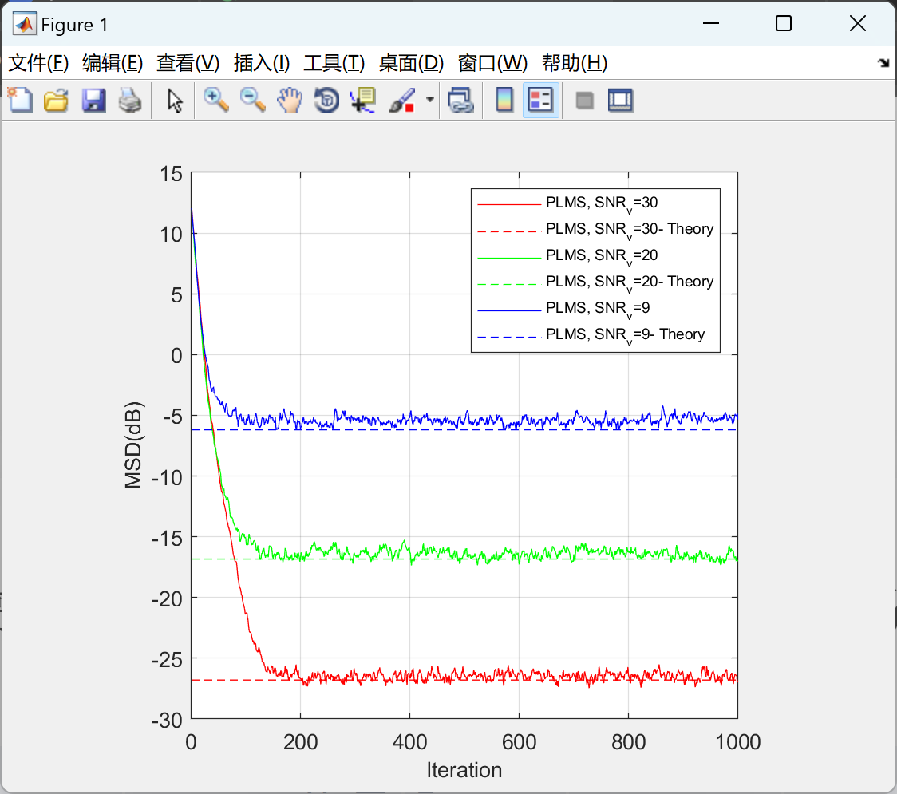

# Probability Minimum Mean Square (PLMS) Adaptive Filters

[Probabilistic Least Squares (PLMS) Adaptive Filter] PLMS has strong robustness against Gaussian and non-Gaussian noise (Matlab code implementation).

## Images

<!-- PAYMENT_BLOCK -->

## Get this dataset

- Payment link (Stripe): [Buy now](https://buy.stripe.com/3cs8yP7sY87d0vu9AB)
- Payment QR code: 

<!-- /PAYMENT_BLOCK -->
